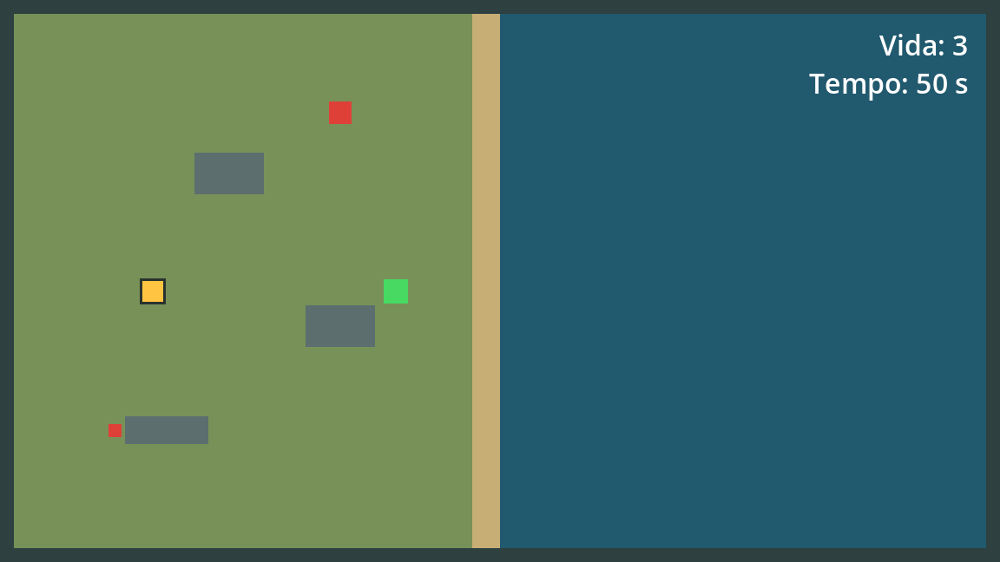

# River Jumper

Projeto de Jogos Digitais II, desenvolvido na Godot 4.7.1 com renderizador Compatibility.

## Carta do projeto

- **Tema:** beira de rio com piranhas saltadoras.
- **Tipo:** Resgate.
- **Modo:** horda, visto de cima; movimento em quatro direções, sem gravidade.
- **Objetivo final:** encontrar 5 aliados, que passam a seguir o jogador em fila.
- **Derrota prevista:** a vida acaba ou um inimigo toca a fila.

## Como jogar

Abra o arquivo `project.godot` na Godot e pressione **F5**. Mova o quadrado amarelo com **WASD** ou com as **setas**.

Na Aula 09, o objetivo é sobreviver **60 segundos**. Cada contato com um inimigo em terra tira uma vida, e a partida termina se você perder as três. Pressione **Enter** na tela de vitória ou derrota para jogar novamente.

Os inimigos saltam do rio. Depois de pousar, dão três pulos em direção ao jogador e desaparecem. Os vermelhos pousam em pontos livres sorteados no terreno. A cada cinco vermelhos, um verde salta para a posição que o jogador ocupava no início do salto. Mova-se antes de ele pousar para desviar.

## Referência do código

O script `scripts/jogador.gd` usa o exemplo [8-way movement da documentação oficial da Godot](https://docs.godotengine.org/en/stable/tutorials/2d/2d_movement.html#way-movement) para o movimento. A velocidade do jogador é 160 px/s.

A perseguição, a horda, o dano e o fim da partida seguem as Partes 1 a 4 do roteiro prático da Aula 09 de Jogos Digitais II. Consulte também [CharacterBody2D](https://docs.godotengine.org/en/stable/classes/class_characterbody2d.html), [Area2D](https://docs.godotengine.org/en/stable/classes/class_area2d.html), [Timer](https://docs.godotengine.org/en/stable/classes/class_timer.html) e [SceneTree](https://docs.godotengine.org/en/stable/classes/class_scenetree.html).

O salto usa [Tween](https://docs.godotengine.org/en/stable/classes/class_tween.html#class-tween-method-tween-method). Os pulos em terra usam [move_and_collide()](https://docs.godotengine.org/en/stable/classes/class_physicsbody2d.html#class-physicsbody2d-method-move-and-collide) em modo de teste para calcular até onde o inimigo pode ir. O pouso aleatório usa [intersect_shape()](https://docs.godotengine.org/en/stable/classes/class_physicsdirectspacestate2d.html#class-physicsdirectspacestate2d-method-intersect-shape) para descartar pontos ocupados.

A adaptação e a configuração do projeto tiveram assistência do Codex.
